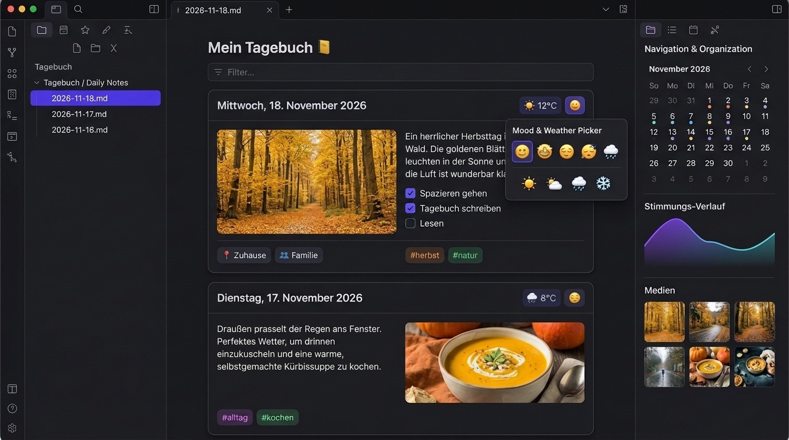

# Journalify

**Journalify** turns your plain Markdown daily notes into an interactive diary feed, vertical timeline, or two-page book view directly inside Obsidian — with **`0` runtime dependencies**, full **Desktop & Mobile** support, and zero proprietary lock-in.



---

## Features

- **100% Plain Markdown & YAML Frontmatter**
  - Reads and writes your standard Obsidian daily notes (`YYYY-MM-DD.md`, `YYYY-MM-DD_dddd.md`, or nested folders like `YYYY/MM/YYYY-MM-DD.md`) without creating a proprietary database.
  - Automatically detects folder, date format, and template settings from **Core Daily Notes** or **Periodic Notes**, and supports multiple switchable journal profiles.
  - Uses Obsidian's `MetadataCache` for fast in-memory indexing across thousands of daily notes with lazy windowed scrolling.
- **3 Switchable Layout Modes + Live Split Sync**
  - **Card feed:** Continuous diary stream with smart folding for long notes or scratchpads below `---`.
  - **Vertical timeline:** Chronological mood-node axis with structured metadata cards.
  - **Two-page book view:** Open book spread with spine shading, favorite ribbon, keyboard page flipping (`←` / `→`), and automatic single-page layout on mobile/narrow panes.
  - **1-click live split sync:** Keep an adjacent native Obsidian Markdown editor synchronized with whichever card you activate.
- **6 Built-in Theme Editions (Light & Dark Mode)**
  - **Obsidian native (default):** Adapts 100% to your active Obsidian theme and accent color.
  - **Warm cozy**, **Clean minimal**, **Creative retro scrapbook** (dot-grid & Polaroid frames), **Classic editorial magazine** (hero banner & drop-caps), and **Typewriter & field logbook** (tabular stamp header & film-strip gallery).
- **Interactive Diary Controls & Safe Inline Editing**
  - Toggle Markdown checkboxes (`- [ ]` ↔ `- [x]`) directly on cards via atomic `vault.process`.
  - Clickable **Mood**, **Weather**, **Location**, and **People** popovers with vault-wide autocomplete chips writing cleanly via `processFrontMatter` (never clobbering foreign frontmatter fields).
  - In-place body editor (protects YAML frontmatter while editing prose) and a zero-ghost-file **Today** quick-start card compatible with Core Templates and **Templater**.
- **Calendar, Mood Analytics, Media Gallery & "On this day"**
  - Responsive right-hand inspector inside the Journalify tab (slide-over drawer on mobile) **and** optionally dockable in Obsidian's global right sidebar.
  - Color-coded monthly mood calendar, pure-SVG mood & activity trend line, writing streak counter, deduplicated photo gallery with zoomable lightbox, native audio/video players, and *"On this day"* memories from previous years.
- **Zero-Dependency Day One Importer (`.zip` & `.json`)**
  - Built-in pure-TypeScript RFC 1951 ZIP/DEFLATE extractor imports Day One `.zip` and `.json` exports (entries, photos, audio, video, weather, places, tags, favorites) on both Desktop and Mobile with UUID duplicate protection.

---

## Frontmatter Reference

All property names are customizable in **Settings → Journalify → Frontmatter property mapping**. Missing properties never show empty clutter — hover or tap a card to add them anytime.

| Property | Example | Description |
| :--- | :--- | :--- |
| `mood` | `😊 Happy`, `🤩`, `4`, `8/10` | Normalized into an emoji, label, and 1–5 score for the calendar & mood chart |
| `weather` | `☀️ 18°C` | Manual picker or optional 1-click Open-Meteo lookup (current & historical dates) |
| `location` | `Home` or `[Park, Cafe]` | Displayed as clickable place badges with autocomplete history |
| `people` | `[Anna, Max]` or `[[Anna]]` | Displayed as people badges (wiki-links are cleaned automatically) |
| `image` | `autumn.jpg` or `[a.jpg, b.jpg]` | Cover/gallery images (also supports aliases `cover`, `banner`, `images`) |
| `starred` | `true` | Marks an entry as favorite (`⭐` filter & book ribbon) |
| `date` | `2026-11-18T14:30` | Optional fallback when filenames do not follow a date pattern (supports multiple entries per day) |

---

## Installation

### Via BRAT (Beta Testing)
1. Install and enable the **BRAT** community plugin in Obsidian.
2. Open **Settings → BRAT → Add Beta plugin** and enter `MarkusLitz/obsidian-journalify`.
3. Enable **Journalify** under **Settings → Community plugins**.

### Manual Installation
1. Download `main.js`, `manifest.json`, and `styles.css` from the latest GitHub Release.
2. Place them into `<your-vault>/.obsidian/plugins/journalify/`.
3. Reload Obsidian and enable **Journalify** under **Settings → Community plugins**.

---

## Privacy & Network Usage

Journalify is **local-first** and requires **no account, no API key, and no telemetry**:
- All notes, metadata, search indexing, SVG charts, and Day One `.zip` extractions run 100% locally on your device.
- **Optional Open-Meteo weather lookup:** Network requests are **only** made when you explicitly search for a city in settings, click **Auto-fetch weather** in the weather popover, or opt into *Auto-fetch weather when creating today's entry*. When used, Journalify queries the free, API-key-less [Open-Meteo API](https://open-meteo.com/) (`geocoding-api.open-meteo.com`, `api.open-meteo.com`, and `archive-api.open-meteo.com`) via Obsidian's `requestUrl`. You can disable weather lookups completely in settings for strictly offline operation.
- External image URLs that you embed in your own Markdown notes (``) are loaded directly from their respective hosts when displayed.

---

## Development & Testing

```bash
npm ci
npm test
npm run build
```

## License

MIT © [Markus Litz](https://github.com/MarkusLitz)
